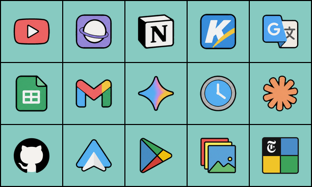

# Tiles Widget

An Android home-screen widget: a grid of app tiles. The grid (1×1 up to 20×20) is set in
settings and always divides the widget, whatever size it is.

## Settings (per widget)

Every placed widget has its own settings, so e.g. the phone home screen and DeX can differ.
Open them by long-pressing a widget → settings, tapping an empty tile, or from the app
(lists every widget, plus the defaults new widgets start with).

- **Grid:** columns and rows, 1–20 each.
- **Tiles:** tap a tile to choose any installed app; its icon is the app's own icon or one of the
  bundled hand-drawn icons.
- **Icon size**, **background colour** (with opacity), **outline** (none–5 dp, any colour, around
  the widget and between tiles) and **corner radius** (0–32 dp): the same controls as the
  Particular Calendar widget.
- **Copy settings from…** another widget or the defaults.

New widgets start with the original 5×3 layout.

## Install

Every push builds an APK in GitHub Actions (**Actions → Build APK → artifact
`tiles-widget-apk`**). Or build locally: `./gradlew assembleRelease` (needs the Android SDK).
