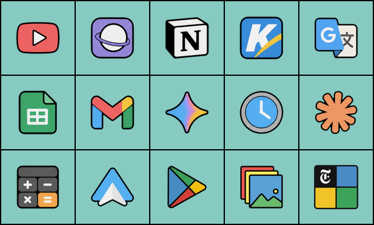

# Tiles Widget

An Android home-screen widget: a 5×3 grid of app tiles with no spacing between
them, just a thin outline around the widget and between tiles (1dp black by default).

| Row | Tiles |
|---|---|
| 1 | YouTube · Samsung Internet · Notion · **K (unmapped)** · Google Translate |
| 2 | Google Sheets · Gmail · Gemini · Clock · Claude |
| 3 | Calculator · Android Auto · Play Store · Gallery · NYT Games |

## Install

Every push builds an APK in GitHub Actions (**Actions → Build APK → artifact
`tiles-widget-apk`**). Install it, then long-press the home screen →
Widgets → *Tiles Widget*.

Or build locally: `./gradlew assembleRelease` (needs the Android SDK).

## How tiles launch apps

Each tile knows a list of package names (e.g. Clock tries Samsung Clock, then
Google Clock) and launches the first one installed. Clock, Calculator, Gallery
and Samsung Internet also fall back to the system's default app of that kind.

If a tile has nothing to open, tapping it opens a picker for that tile.

## Remapping tiles

Open the **Tiles Widget settings** app (or reconfigure the widget: long-press it →
settings on Android 12+). Tap any tile to point it at any installed app, or
reset it to its default. Mappings are resolved at tap time, so they apply
immediately.

## Tweaks

- Appearance (tile colour + opacity, outline width 1–5dp, black/white outline, corner radius 0–30dp) is set in the app's settings screen.
- Default apps per tile: `TILES` in `app/src/main/java/.../Tiles.kt`.
